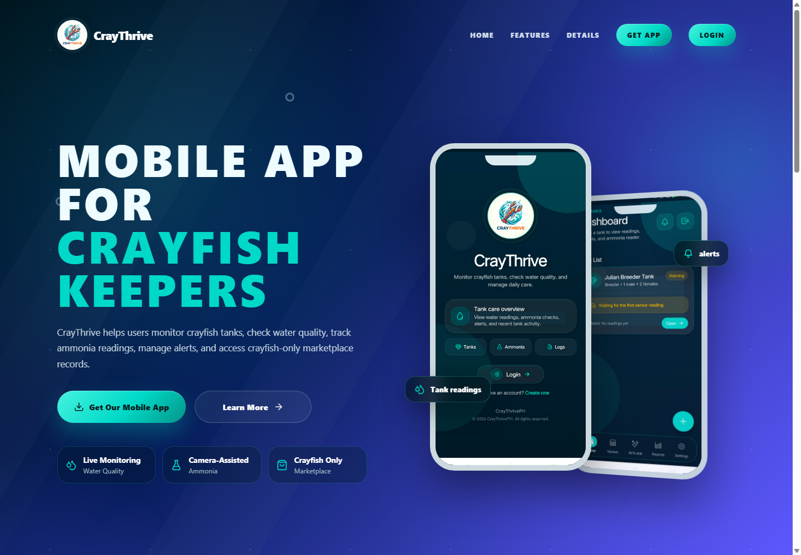

# CrayThrive Web

The web dashboard for my CrayThrive capstone: a crayfish farm monitoring and management system built with React, Vite, and Supabase.

The dashboard brings tank readings, water-quality history, alerts, device controls, reports, and marketplace operations into a browser interface. It accompanies the [CrayThrive mobile application](https://github.com/Julian-Dev-Web/craythrive-mobile).

[Website](https://www.craythrive.site/) · [Mobile source](https://github.com/Julian-Dev-Web/craythrive-mobile)

## My role

**Capstone project lead and sole software developer — [Julian](https://github.com/Julian-Dev-Web).**

I developed the web interface, Supabase integration, monitoring and threshold workflows, device-facing control integration, marketplace screens, and application checks. This repository presents the web portion of my software implementation within the capstone team.

## Screenshot



Public landing-page capture from October 22, 2026. No farmer account, private tank data, or device controls were used for this screenshot.

## Features

- **Tank management:** tank creation, details, planning, saved readings, and water-quality history.
- **Monitoring and thresholds:** sensor-specific condition rules, configurable per-tank thresholds, alerts, and separate manual ammonia records.
- **Farm operations:** feeding schedules, supported actuator controls, emergency-stop handling, and activity history for compatible backend/firmware deployments.
- **Reporting:** tank reports, charts, date filters, and printable summaries.
- **Marketplace:** product listings, seller information, customer orders, and seller workflows.
- **Accounts and administration:** authentication, password recovery, account settings, and restricted developer tools.

Hardware commands require the correct backend and compatible devices. A UI label or an AI recommendation does not establish that an actuator ran.

## Technology

| Area | Tools |
| --- | --- |
| Interface | React 19, Vite, React Router, Lucide |
| Backend | Supabase Auth, PostgreSQL, Storage, Realtime |
| Charts | Recharts |
| Integration | ESP32 firmware and device-related SQL/functions |
| Validation | Node test runner, Playwright, PGlite, ESLint |

## Run locally

```sh
npm ci
```

Copy `.env.example` to `.env.local` and supply your own Supabase URL and public publishable key. The supported names are documented in that example; a legacy anon key is also supported.

```sh
npm run dev
```

The application requires the CrayThrive backend tables, RPCs, storage policies, and compatible device configuration. The repository contains incremental SQL and firmware integration source, not a complete one-command installation of the whole farm system. Private service-role, provider, database, and webhook credentials belong on the server.

## Development checks

```sh
npm test
npm run test:browser
npm run lint
npm run build
npm run security:scan
```

The browser suite uses an isolated mock backend. Install its browser dependencies or configure `QA_BROWSER_PATH` for your machine. Local checks do not prove hardware operation or every live backend policy.

- [QA report](qa/PRE_RELEASE_QA.md)
- [Security audit](security/PRE_PRODUCTION_AUDIT.md)
- [Per-tank thresholds](docs/PER_TANK_THRESHOLDS.md)
- [Feeding schedules](docs/AUTOMATIC_FEEDING_SCHEDULE.md)
- [Device stop and feeding behavior](docs/ACTUATOR_STOP_AND_FEEDING.md)

## Explore the implementation

```text
src/pages/          Authentication, monitoring, reports, and marketplace screens
src/components/     Reusable interface components
supabase/           Backend migrations and integration SQL
firmware/           Device integration source
tests/              Unit, database, and browser checks
docs/               Implementation notes and screenshots
security/           Audit scripts and authorization guidance
```

<details>
<summary>Earlier development and verification notes</summary>

React + Vite SPA using Supabase Auth, Database and Storage.

Copy .env.example to .env.local and supply the actual Supabase project URL and publishable key. A legacy anon key remains supported. VITE_APP_SITE_URL optionally sets the canonical password recovery origin. These values are public browser configuration. Private provider, service-role, database and webhook credentials belong only in a server environment.

The existing local .env was malformed JavaScript rather than dotenv configuration. It was removed from Git tracking and left intact locally. Actual runtime credentials were not fabricated or replaced.

Commands: npm ci; npm run dev; npm run build; npm run lint; npm run test:security; npm run security:scan; npm audit.

The build validates browser environment names/key types and scans dist for private credential signatures. These checks do not replace database authorization or a full secret scanner.

See [the pre-production security audit](security/PRE_PRODUCTION_AUDIT.md) for exact changes, validation, remaining risks and manual Supabase/Vercel steps. No deployment was performed. Live RLS, Storage and the AI backend remain unverified because their schema/source was absent from this workspace.

Pre-release QA: `npm test` runs security and monitoring regressions; `npm run test:browser` runs the production-bundle browser suite against an isolated mock backend. The browser suite uses installed Chrome on this Windows workspace; other machines can set `QA_BROWSER_PATH` or install Chromium with `npx playwright install chromium`. It never uses the real Supabase project. See [the QA report](qa/PRE_RELEASE_QA.md) for results, fixes, remaining ESLint failures and the live checks still required.

</details>
